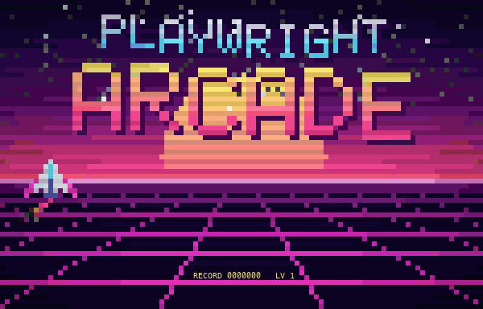
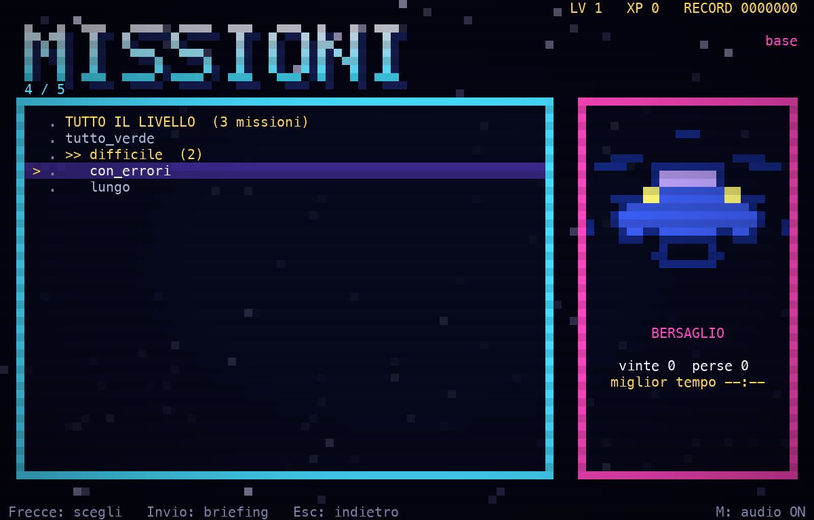
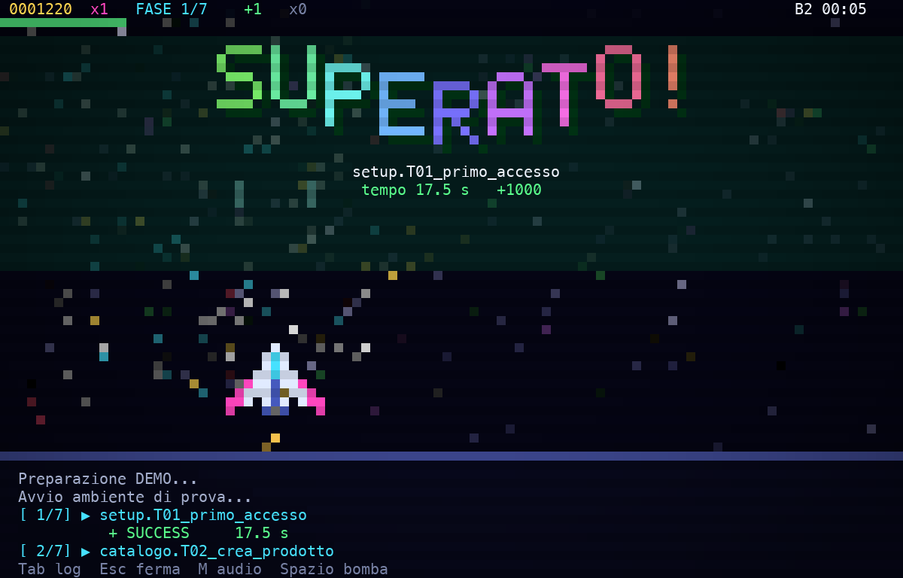
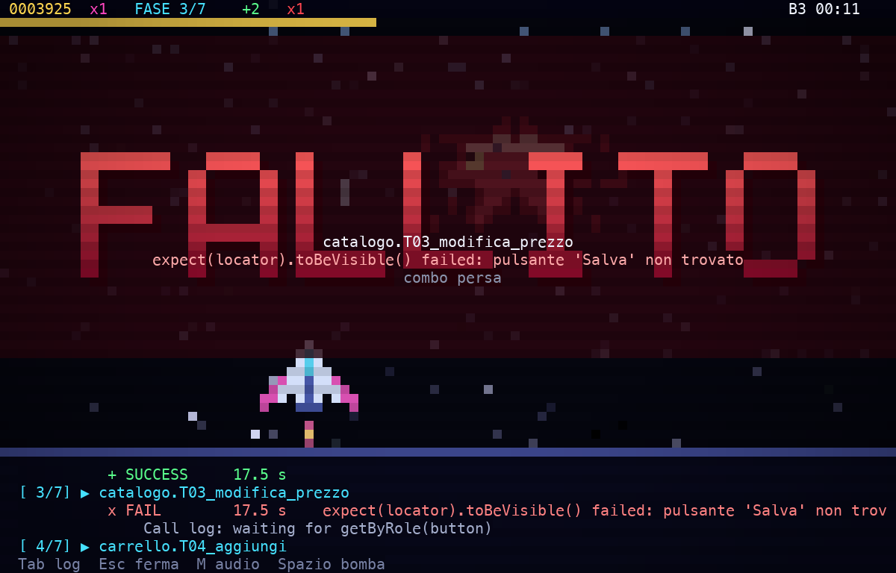
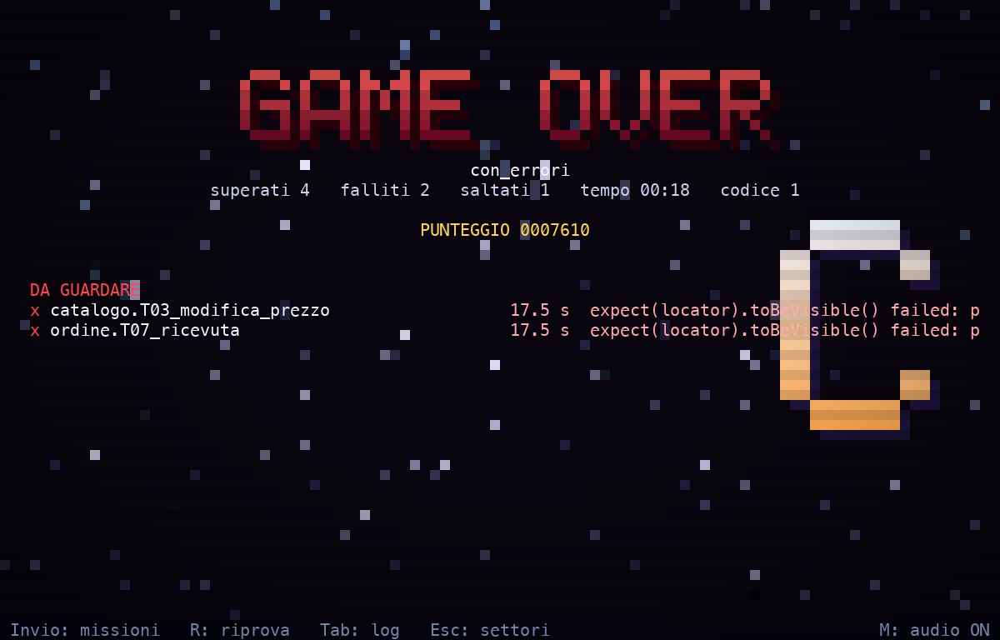

<div align="center">



# 🕹️ PLAYWRIGHT ARCADE

**I TUOI TEST E2E SONO BOSS. ABBATTILI.**


`>> PREMI INVIO PER INIZIARE <<`

</div>

Un launcher di test Playwright a forma di sparatutto da terminale. Grafica a pixel, musica sintetizzata e un boss per ogni test: quello che vedi e senti viene dagli esiti veri del runner.

## 🪙 Inserisci il gettone

```bash
git clone https://github.com/dambrosini92/playwright-arcade.git
```

### macOS e Linux

```bash
cd playwright-arcade
```

```bash
python3 -m pip install --user -r requirements.txt
```

```bash
./arcade --demo
```

Su macOS usa `/usr/bin/python3` per l'installazione: è quello che avvia il gioco. Su Linux serve anche PortAudio, per esempio `sudo apt install libportaudio2`.

### Windows

Da Windows Terminal:

```bat
cd playwright-arcade
py -3 -m pip install -r requirements.txt
arcade.bat --demo
```

> **BETA:** su macOS il gioco è provato a fondo. Linux è provato senza audio e Windows non è ancora mai stato giocato su una macchina vera. Se qualcosa si rompe, apri una issue.

La demo non tocca nessun progetto: è una suite finta con vittorie, errori, crash e test velocissimi. Serve una finestra di almeno 80×24, ma il gioco rende meglio da 120×40 in su.

## 🗺️ Scegli il livello



| Schermata | Cos'è |
|---|---|
| **SETTORI** | I tuoi progetti, ognuno con il suo pianeta |
| **LIVELLI** | I file di spec oppure, per i runner a nodi, i gruppi di id: `accesso.T01_login` sta nel livello `accesso` |
| **MISSIONI** | I singoli test |

- **TUTTO IL LIVELLO** lancia l'intero gruppo.
- Le righe `>>` lanciano un sotto-gruppo, le altre una missione singola.
- Dalla lista dei livelli, Spazio va dritto al briefing del livello intero.
- I test senza gruppo finiscono nel livello SPECIALI.

Invio apre il briefing, un altro Invio fa partire il conto alla rovescia e il test, nel browser visibile. Se il progetto lascia un rapporto su disco, contano anche le partite giocate fuori da arcade.

## 👾 Boss fight

| | Esito | Cosa succede |
|---|---|---|
|  | **SUPERATO!** | Il boss esplode tra fuochi d'artificio e coriandoli, l'arpeggio sale con la combo e l'arma si potenzia |
|  | **FALLITO** | Il boss ti colpisce, lo schermo trema, la scena perde colore sotto la pioggia e appare il messaggio d'errore |
| | **SALTATO** | Il boss se ne va, con un breve avviso |

> **REGOLA DELLA SALA:** punteggio e rango sono solo gioco. Il verdetto viene dal codice di uscita e dagli esiti del test, mai da come hai giocato. Il boss muore solo se il test passa.

## 🎮 Comandi

| Tasto | In battaglia | A fine partita |
|---|---|---|
| Frecce | Muovi la nave (se non tocchi nulla, guida il pilota automatico) | |
| `Spazio` | Bomba | |
| `Tab` | Log completo | Rilegge il log |
| `M` | Audio sì/no, e la scelta viene ricordata | |
| `Esc` | Ferma il test | Torna ai settori |
| `Invio` | | Torna alle missioni |
| `R` | | Riprova |
| `Ctrl+C` | Chiude tutto | Chiude tutto |

## 🏆 Hi-score



Record, livello ed esiti per test stanno in `save.json`: cancellalo per ripartire da zero.

## 🌍 Aggiungi i tuoi mondi

I tuoi progetti stanno in `local/projects.py`, che git ignora. Parti dall'esempio:

```bash
mkdir -p local && cp projects.example.py local/projects.py
```

Per una suite Playwright standard basta `PROJECTS`: il gioco cerca `playwright.config.*` e la lancia. Le altre voci dell'esempio sono facoltative e servono per runner propri, rapporti su disco, tunnel o avvisi nel briefing. Per un formato di output nuovo, modifica `parse_line` in `game.py`.

Per leggere l'elenco senza avviare nulla:

```bash
./arcade --list NOME
```

## 🔊 Non senti nulla?

```bash
./arcade --audio-test
```

Fa suonare il motore vero (su Windows: `arcade.bat --audio-test`). Un guasto appare in basso a destra e il motivo finisce in `audio.log`.

## 🔧 Dentro il cabinato

| File | Cosa fa |
|---|---|
| `core.py` | Scoperta dei test e comandi |
| `game.py` | Scene, battaglia e lettura delle righe dei reporter |
| `gfx.py` | Grafica a pixel nel terminale, a 24 bit oppure 256 colori (`ARCADE_COLOR=256` per forzarli) |
| `audio_engine.py` | Mixer in tempo reale in un processo a parte: CoreAudio su macOS, `sounddevice` altrove |
| `sysio.py` | Ciò che cambia tra i sistemi: tastiera, console e processi |
| `tools/make_audio.py` | Sintetizza musica ed effetti in `assets/` |
| `projects.example.py` | Modello per `local/projects.py` |

<div align="center">

`GAME OVER? PREMI R PER RIPROVARE`

</div>
